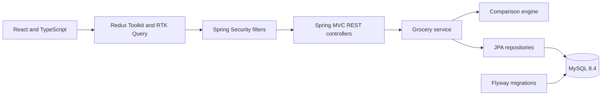
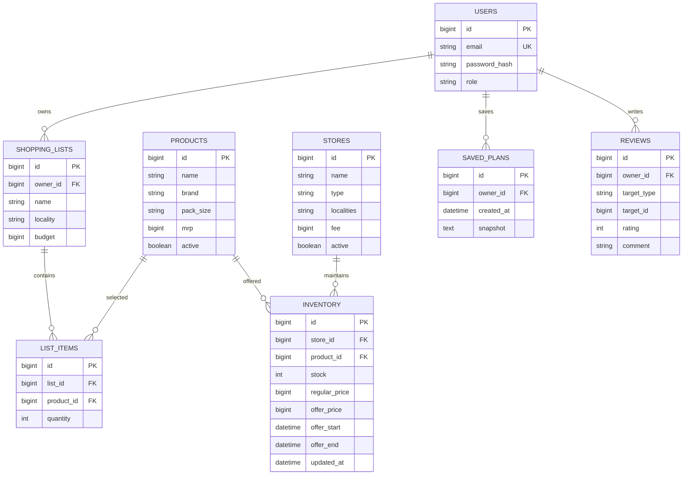

# Architecture and data design

The application separates the React interface, Spring MVC REST layer, Java business services, and MySQL persistence. `Api.java` defines HTTP contracts and delegates to `GroceryService.java`, which handles ownership rules, orchestration, transactions, and JPA repositories. The comparison engine is a pure Java service with immutable input/output records and no dependency on authentication or persistence.

Saved plans embed their selected basket, exact product descriptions, timestamps, and original comparison request as JSON in an immutable LONGTEXT snapshot. Embedding the item data keeps historical plans unchanged when the catalog is edited. Each review identifies a product or store; the service validates that target. Serviceable localities use a comma-separated list for this course project.

## Exact comparison

All prices are positive integer paise; quantities are integers from 1 to 999. Each comparison accepts up to 100 unique product lines. The selected brand and pack size are fixed by product ID. Each line's full quantity must be available at its assigned store.

For every eligible single store and unordered store pair, the engine chooses the lowest item cost for each line. For any fixed pair that uses both stores, fees are constants, so choosing each line's lowest available price minimizes that pair's subtotal. If choosing the cheapest lines leaves one store unused, that candidate is covered by a single-store calculation. Comparing all singles and pairs therefore finds the minimum complete basket using up to two stores. This reasoning depends on fixed fees, no conditional coupons or order minimums, no split quantities within a line, and no travel-cost model.

Incomplete baskets list missing product IDs and never enter the complete ranking. All-store screens order complete baskets first and then by total, store count, and stable store name. Split-store screens contain plans that actually use two stores; a split plan can be more expensive than the winning single store. The summary recommends the cheaper complete option. `splitSavings` is zero when splitting provides no monetary benefit or there is no comparable complete single basket.

Offer eligibility is `offerStart <= now < offerEnd`; otherwise regular selling price applies. Offers are never deducted twice. Discounts displayed are savings relative to MRP. Fixed fees apply once to each used online store, and local pickup has zero delivery fees. Inventory timestamps older than 24 hours are flagged rather than excluded.

## Identity and access

Spring Security handles form login and session fixation protection. The session ID is HTTP-only and SameSite=Lax. GET `/api/auth/csrf` supplies a Spring-generated masked CSRF token and its required header name. The client obtains a token before each write, including login, registration, and logout; it does not disable CSRF or store passwords/tokens in browser local storage.

Passwords use Spring's BCrypt encoder. User registration always creates a SHOPPER; role fields supplied by a client are ignored. Administrator identity is seeded from ignored environment variables. Admin routes require ADMIN at the security filter layer. User-owned mutations verify ownership on the server and return 404 for another user's record. Public review responses omit account emails and password hashes. Server-side validation rejects fractional quantities, invalid prices, malformed offer windows, and unknown targets.

## Storage and runtime

Flyway owns schema evolution; Hibernate validates instead of creating tables. Seed content is separate Java application data logic and runs only when the product catalog is empty. It is transactional and does not overwrite maintained prices during restart. Admin account creation is idempotent by email. MySQL uses a named Docker volume. The final Docker image is an unprivileged Java 21 runtime serving both React assets and the API; only the localhost-bound port is exposed to the host.
